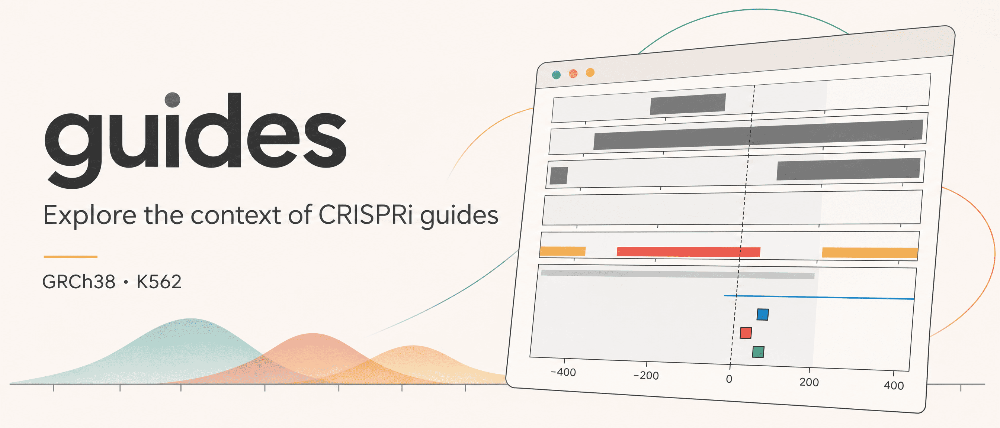

<p align="center">
  <a href="https://github.com/eizorerad/guides/releases/latest">
    
  </a>
  <a href="https://github.com/eizorerad/guides/actions/workflows/reproduce.yml?query=branch%3Amain">
    
  </a>
  <a href="LICENSE">
    
  </a>
  <a href="pixi.toml">
    
  </a>
</p>

<p align="center">
  
</p>

A terminal tool that maps published or custom CRISPRi guides to a gene and
compares their regulatory context in a Quarto report.

**Scope:** human GRCh38, K562, SpCas9/NGG. Guides come from Dolcetto Set A or
your own sequences. The report shows transcription start site (TSS) windows,
DNase, H3K4me3, H3K27ac and CTCF peaks, and ENCODE candidate promoter/enhancer
annotations.

**Question:** how does regulatory context differ between guides targeting the
same gene? This is descriptive annotation: it does not predict guide efficacy,
genome-wide specificity or enhancer-to-gene links. See [methods](docs/methods.md).

## Install and reproduce

Requires **Linux x86-64**, a CPU, **4 GB RAM**, **4 GB free disk** and
[Pixi](https://pixi.sh/latest/installation/). Internet is needed for installation
and initial downloads; demo inputs total about 152 MB and are cached for reuse.

```bash
git clone https://github.com/eizorerad/guides.git
cd guides
pixi install --locked
pixi run reproduce
```

Open **`reports/COTL1-dolcetto.html`** in a browser. Quarto recomputes the
analysis, tables and figures during rendering. To reproduce the released
version, run `git checkout v0.2.1` before `pixi install --locked`.

## Usage

Run from the repository directory:

```bash
pixi run guides                      # interactive menu
pixi run guides help                 # also --help or -h
pixi run guides --gene COTL1          # Dolcetto Set A guides
pixi run guides --gene COTL1 --guides GGTACGCGCCGAGGGCGCAC CGGCGGTGGCGACGGCTACG
pixi run guides --gene COTL1 --guides-file spacers.txt
pixi run guides --gene COTL1 --json > report.json
```

Use an exact GENCODE v32 gene symbol or an unversioned Ensembl gene ID.
Custom spacers require a gene and **20 A/C/G/T bases, 5′–3′, without PAM**;
put one spacer per line in a file. Dolcetto Set A normally supplies three
guides per gene.

Commands with `--gene` run without prompts. Add `--json` for one JSON object
on stdout with absolute `report` and `results` paths; progress goes to stderr
and errors return a nonzero exit code. Check `guides.csv` for not-found or
ambiguous guides, which can appear in a successfully generated report.

Optional: run `bash scripts/install_command.sh` to install the `guides`
launcher in `~/.local/bin` (or `XDG_BIN_HOME`). With that directory on `PATH`,
use `guides` instead of `pixi run guides` from any directory. Keep the repository
at its installed location.

## Outputs

Reports are saved as `reports/GENE-mode.html`, where mode is `dolcetto` or
`custom`. Supporting files are in `results/GENE-mode/`:

| Files | Contents |
| --- | --- |
| `locus.png`, `locus.svg` | Locus map |
| `guides.csv`, `placements.csv`, `ccres.csv` | Guide status, local matches and regulatory annotations |
| `request.json`, `provenance.json` | Inputs, settings, source URLs and file hashes |
| `software.json`, `render.log` | Software versions and Quarto log |

The COTL1 demo should place all three Dolcetto guides uniquely in the local
search window. See [validation](docs/validation.md) for reference results.
Run one report at a time; rerunning the same gene and mode replaces its outputs.

## Data availability and licenses

All reference inputs are public: Dolcetto/Addgene, GENCODE v32, UCSC GRCh38 and
ENCODE K562 peaks/cCREs. No cluster account or private data are needed.
Downloads are MD5-verified and stored read-only in `data/raw/`; raw data,
generated outputs and environments are excluded from Git. Exact sources,
versions and terms are in [sources.json](metadata/sources.json), with hashes in
[checksums.md5](metadata/checksums.md5).

Code: [MIT](LICENSE). Documentation and artwork:
[CC BY 4.0](https://creativecommons.org/licenses/by/4.0/).
Third-party data retain their providers' terms, including Addgene's commercial-use
restrictions. Full citations and terms: [licenses and attribution](docs/licenses.md).

## Repository and capstone

| Location | Contents |
| --- | --- |
| `src/guides/` | CLI, downloads, analysis and plotting |
| `config/settings.toml` | Demo gene and analysis windows |
| `metadata/` | Source records and checksums |
| `reports/report.qmd` | Executable report |
| `pixi.toml`, `pixi.lock` | Tasks and locked environment |
| `tests/`, `scripts/`, `.github/workflows/` | Tests, launcher installer and reproduction CI |
| `docs/` | Methods, licenses, validation and capstone evidence |

See the [capstone checklist](docs/capstone.md) for rubric evidence and the
remaining independent partner reproduction. See
[pull requests](https://github.com/eizorerad/guides/pulls?q=is%3Apr) and
[releases](https://github.com/eizorerad/guides/releases) for the change history.

## Citation and contact

Klarov, Leonid (2026). *guides: reproducible CRISPRi guide context in K562*,
version 0.2.1. [CITATION.cff](CITATION.cff).
No associated paper; dataset citations are included in each report.

Contact: Leonid Klarov <leonid.klarov@gmail.com>.
See [CONTRIBUTING.md](CONTRIBUTING.md) and [CODE_OF_CONDUCT.md](CODE_OF_CONDUCT.md).
